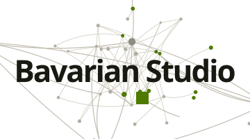

<picture>
  <source media="(prefers-color-scheme: dark)" srcset="./bavarianstudio_logo_lockup_ruhend_dunkel.svg">
  
</picture>

# Bavarian Studio

An AI studio in Munich. AI agents carry the development, design, operations, marketing and support; the human decides and signs off. What comes out of it runs in production.

**[studio.bavarian.app](https://studio.bavarian.app)** · **[AI consulting](https://studio.bavarian.app/en/ki-beratung/)**

## How the work runs

The human has the idea, decides and signs off. A planning stack cuts the idea into assignments and checks every result against the rules. Build lanes work in parallel, each in a sealed-off workspace with its own audit record. A design stack drafts the interfaces, and an operations stack runs agents with fixed business roles around the clock. Assignments go out by messenger and results come back the same way. Reversible steps go through; the business-critical gates stay with the human.

## What runs on it

**[Northmeadow](https://northmeadow.ai)** · Alpha 1, free  
The company brain for AI agents and people. Notes are encrypted per mandate before they are stored, local agents such as Claude Code and Codex work from a plain Markdown folder copy, and every access lands in a record the company checks itself.  
[Download Alpha 1](https://github.com/bavarian-studio/northmeadow/releases/tag/v0.1.0-alpha.1) · [Discussions](https://github.com/bavarian-studio/northmeadow/discussions)

**[LearnBavarian](https://learn.bavarian.app)** · Live, beta  
Learning Bavarian with dialect characters, in 10 languages, hosted in the EU.

**[translate.bavarian.app](https://translate.bavarian.app)** · In progress  
German, English and Bavarian, in both directions.

More projects: [studio.bavarian.app](https://studio.bavarian.app)

## Contact

Outbound only, so you decide whether a conversation starts:
[hello@studio.bavarian.app](mailto:hello@studio.bavarian.app) ·
[WhatsApp](https://wa.me/491738676604)

Deutsch: [studio.bavarian.app/de/](https://studio.bavarian.app/de/)
